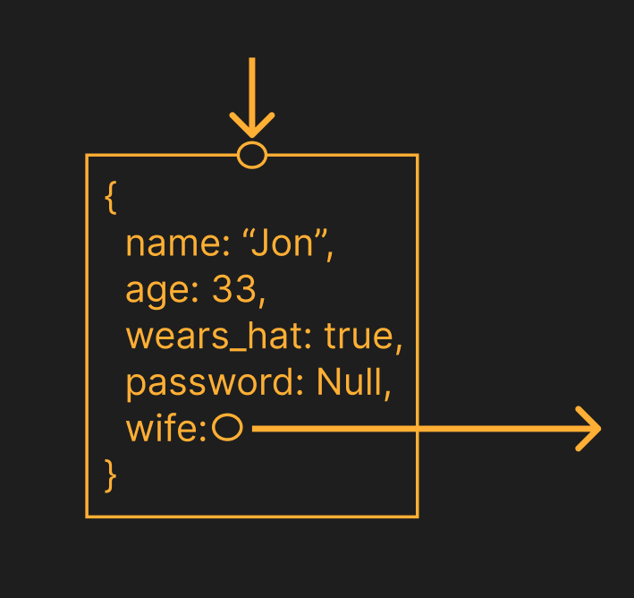
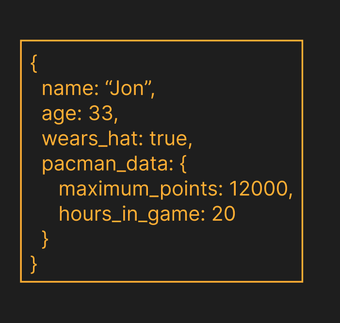
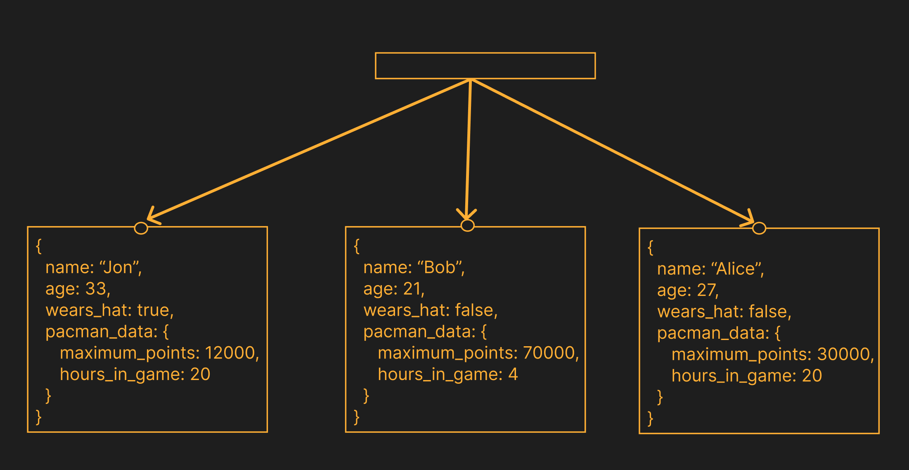
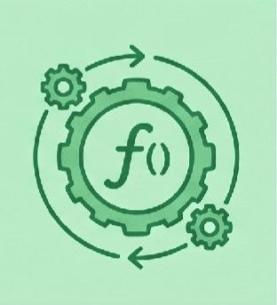

# Data Model


COG implements its own data model with node, edges and hyperedges.

## Nodes

A node is a container for an object.



Object fields are dynamically typed: string, number, bool, null, link or subobject. A link is a reference to another entity — node, edge, hyperedge, or a sub-object inside another field.

A node can be *free* — having no incoming or outgoing edges and not being a member of any hyperedge.

### Subobjects



A *subobject* is a field inside an entity's `Object` whose value is itself an `Object` (or any nested field reachable through a chain of object-typed fields). A subobject has **no identity of its own**: it doesn't appear in `iter_entities`, has no UUID, and is addressed by a `GlobalPath` of the form `<entity-uuid>/<field>[/<field>...]`.

Subobjects are not entities. They cannot:
- be classified by `get_type` (which is for ids);
- carry an *attached object* (see below);
- be the target of `attach_obj`.

Subobjects **can** be:
- the source or target of an edge,
- a member of a hyperedge,
- the target of a `Field::Link` (i.e. `Pointee::Path`).

## Edges

An edge is a directed link between any two entities — nodes, suboject, edges, or hyperedges — so any combination of endpoints is allowed, including self-loops.

An edge whose at least one endpoint is itself an edge or hyperedge is called a *metaedge*. Metaedge is a classification, not a separate storage type: every metaedge is just an edge.

## Hyperedges



A hyperedge groups an arbitrary number of pointees (entities or subobjects) without imposing direction or pairing. A hyperedge is essentially a subgraph or what will later be called a `space`.

## Attached objects

An *attached object* is an `Object` that piggy-backs on top of an edge or hyperedge, sharing its id. It lets structural elements (edges, hyperedges) carry data without introducing a proxy node.

## Invariants

- *Endpoints exist.* Every edge has both endpoints alive. Deleting an entity cascades to all edges that have it as source or target, and recursively to metaedges that depended on those edges.
- *Hyperedge membership.* When a member of a hyperedge is deleted, it is removed from the hyperedge. A hyperedge that becomes empty is itself deleted (which in turn cascades to any edges that have it as source or target).

## Input and derived facts

Every entity belongs to one of two layers.

- **Input facts** come from the outside world: clients, mutators, host code that calls `db::Graph` directly. In a compiler these are the parsed sources, in an IDE whatever the user typed.
- **Derived facts** are written by [views](#view). Name-resolution edges, inferred types, diagnostics are derived facts. Every derived entity is *owned* by the view invocation that created it, and only that invocation may change or remove it.

The layers are told apart by the ids themselves. Input ids are random (UUIDv4). Derived ids are computed from the owning invocation (UUIDv8, see [Stable ids](#stable-ids)).

Two rules follow from the split:

- **Inputs never depend on derived facts.** An input write cannot see derived entities: removing or changing one, or pointing an edge or hyperedge at one, fails with the same error as if the entity did not exist. Derived facts may point at inputs, never the other way round. Reads are not restricted.
- **Derived facts are a cache.** They can always be thrown away and recomputed from the inputs. They are never undone and never need to be persisted.

# Coding model



So, how to interact with the database using code and organize it?

## Dialect and not query DSL

Instead of creating a query language, COG's proposes a Rust dialect. When we say dialect, we mean that the Rust side provides intrinsics and macros that will be processed by the JIT.

### Kind of functions

The database supports three kinds of functions: `mutator`, `view` and `procedure`.
- `mutator` writes input facts.
- `view` derives facts from what is already in the graph and writes them into the same graph. The database keeps them up to date when the graph changes.
- `procedure` is a pure function that takes `object`s and returns an anonymous `space`.

### Mutator

Something populates the database with input facts. Such functions are called `mutator`.

```rust
    #[mutator]
    fn 
```

**Not implemented yet.** For now inputs are written by the host through `db::Graph`.

### View

In traditional databases, views are created using schemas and modified by queries. COG uses functions instead. A view receives the graph as `&mut Graph`, reads whatever it needs and adds derived facts:

```rust
use sdk::{Field, Graph, Object, view};

#[view]
fn hello_view(g: &mut Graph) {
    let mut obj = Object::new();
    obj.insert("Hello".to_string(), Field::String("World".to_string()));
    g.add_node(obj);
}
```

A view that takes only the graph runs once for the whole graph. Most views in a language tool are about one thing — one use site, one function, one expression — and should run once per such thing. That's what `for_each` is for:

```rust
use sdk::{Field, Graph, NodeId, Pattern, view};

/// Link every use site to the definitions with the same name.
#[view(for_each = Pattern::nodes_where("kind", "use"))]
fn resolve(g: &mut Graph, use_site: NodeId) {
    let Some(name) = g.field(use_site, "name") else { return };
    for def in g.nodes_where("name", name) {
        if g.field(def, "kind") == Some(Field::from("def")) {
            g.add_edge(use_site, def).unwrap();
        }
    }
}
```

The database runs `resolve` once for every node whose `kind` field is `"use"` and passes that node as the key. One run of a view for one key is called an *invocation*. When a matching node appears, a new invocation is created. When the node disappears or stops matching, its invocation is dropped together with everything it wrote.

| Pattern | Runs for |
|---|---|
| `Pattern::nodes()` | every node |
| `Pattern::nodes_where(field, value)` | every node whose top-level `field` equals `value` |

Inside a view `Graph` is not a plain handle to the database:

- **Every read is recorded.** This is how the database knows when an invocation has to run again.
- **Writes are owned.** An invocation can create nodes, edges and hyperedges and point them at anything it can see. It can change or remove only what it created itself during the current run. Everything else is reported as "not found".
- **A view does not see its own previous results.** When an invocation runs again, what it wrote last time is hidden from it until it writes it again. A re-run sees exactly what a first run would see.

The details are in [How COG does it](#how-cog-does-it).

### Procedure

Database can also contain `procedure`. The procedure takes N object as parameters and returns an anonymous graph, meaning it is not stored in the database, but is only transmitted to the client

```rust
    #[procedure]
    fn hover(obj1: Object, obj2: Object ...) -> Graph {
        ...
    }
```

**Not implemented yet.**

## DB stored code

### For what?

The primary way to build COG applications is to place code within the database. This aligns with DAD: firstly, we strive to maintain code and data locality, and secondly, we want to inspect the code just-in-time (JIT) for subsequent optimizations.

### Your first module

Ok, lets create new folder `hello_view`.

Next, create `Cargo.toml` with following code:

```toml
[package]
name = "hello_view"
version = "0.1.0"
edition = "2024"

[lib]
crate-type = ["cdylib"]

[dependencies]
sdk = { path = "../../crates/sdk" }

[profile.release]
opt-level = "s"
lto = true

[workspace]
```

And `.cargo/config.toml`, so that the module is built for WASM:

```toml
[build]
target = "wasm32-unknown-unknown"
```

Ok, next create file `src/lib.rs` with following content:

```rust
use sdk::{Field, Graph, Object, view};

#[view]
fn hello_view(g: &mut Graph) {
    let mut obj = Object::new();
    obj.insert("Hello".to_string(), Field::String("World".to_string()));
    g.add_node(obj);
}
```

Ok, we just wrote our first view. It derives a single node, and the database will keep that node in place.

### Running it

`cargo build --release` produces `target/wasm32-unknown-unknown/release/hello_view.wasm`. The host loads it into a database and propagates:

```rust
use db::Graph;
use jit::Runtime;

let mut host = Runtime::new().host(Graph::default())?;
host.load(&std::fs::read("hello_view.wasm")?)?;
host.propagate()?;                  // runs every view once

host.graph_mut().add_node(obj);     // change the inputs...
host.propagate()?;                  // ...and re-run only what depends on the change
```

`propagate` returns a report: which invocations ran and which of them failed.

# Client's

In the previous section, we created a simple WASM module. Now let's create two clien't and verify that's all work correct.

<!-- TODO -->

# Reactivity and incrementality

Before we continue we need to be familiar with two concepts reactivity and incrementality

### What reactivity is?

Imagine we have the following code:

```
    let v3 = v1 + v2;
    let v4 = v3 + v5;
```

For it we can construct the following DAG:

```
    v1 ──┐
         ├──▶ (+) ──▶ v3 ──┐
    v2 ──┘                 │
                           ├──▶ (+) ──▶ v4
    v5 ────────────────────┘
```

Each node here is either an input (`v1`, `v2`, `v5`), an operation (`+`), or a derived value (`v3`, `v4`). Edges encode the *data dependencies*: `v3` depends on `v1` and `v2`; `v4` depends on `v3` and `v5`.

Reactivity is the property that, whenever an input changes, every value that transitively depends on it is recomputed automatically — and nothing else is touched. If the user updates `v1`, the runtime walks the outgoing edges from `v1`, sees that `v3` is dirty, recomputes `v3`, then sees that `v4` depends on `v3` and recomputes `v4` too. If instead only `v5` changes, `v3` is left alone and just `v4` gets recomputed. The DAG tells the runtime exactly which work is needed and which work it can skip.

### What about `if` and `for`?

Real code is not just a chain of `let` bindings — it has control flow. How does the DAG cope?

**Conditionals (`if`, `match`, early `return`).** A branch that wasn't taken on the previous run may be taken now, which means the set of dependencies of a value is itself dynamic — it depends on the inputs. A purely static DAG cannot capture this. The standard fix is to record dependencies *as they are actually read* during a run, so each recomputation rebuilds its own dependency set. This is what frameworks like Salsa and Adapton do, and what COG does too: the DAG shown above is the trace of one particular execution, not a fixed schema. A different input may produce a different DAG.

**Loops (`for`, `while`) over fixed data.** A loop with a known iteration count is just unrolled into the trace: each iteration's reads and writes become more nodes and edges in the dynamic DAG. There is nothing special to handle — the graph is simply larger.

**Loops over a collection that itself changes.** This is the genuinely hard case. If you write
```
    let total = items.iter().map(price).sum();
```
and a single `item` is added, naive reactivity sees that `items` changed and reruns the entire loop, even though only one element is new. The DAG model has no way to express «the dependency on `items[3]` changed but `items[0..3]` and `items[4..]` did not». This is exactly the gap that **differential dataflow** fills: collection operators (`map`, `filter`, `join`, `reduce`) consume *diffs* (`+item`, `-item`) and produce diffs, so adding one element costs O(1) work, not O(n).

COG takes a coarser but simpler route. `for_each` splits a view into one invocation per key, and the set of keys is maintained as a diff: a new key creates an invocation, a removed key drops one. Inside an invocation the Salsa-style trace is used. Adding one `item` costs one invocation, not a rerun of the whole loop.

## How COG does it

### Invocations

An invocation is one view applied to one key, or to no key for a view without `for_each`. It is the unit of re-execution. For every invocation the database keeps:

- its **read set** — the dependency keys recorded during its last run;
- its **outputs** — the entities it owns.

### Reads are tracked

A view can look at the graph only through host intrinsics, so the database sees every read. Each read is recorded as a *dependency key*:

| Read | Dependency key | Touched when |
|---|---|---|
| `is_exist(id)` | `Entity(id)` | the entity appears, disappears, gets or loses an attached object |
| `classify_pointee(p)` | `Entity(id)`, `Edge(id)` | as above, or the edge's endpoints change |
| `obj(id)` | `Obj(id)` | anything in the object changes |
| `field(id, name)` | `Field(id, name)` | that one field changes |
| `edge(id)` | `Entity(id)`, `Edge(id)` | the edge appears, disappears or is retargeted |
| `hyperedge_members(id)` | `Members(id)` | the members change |
| `out_edges(p)`, `in_edges(p)` | `OutEdges(p)`, `InEdges(p)` | an edge from / to `p` is added, removed or retargeted |
| `hyperedges_of(p)` | `HyperedgesOf(p)` | `p` joins or leaves a hyperedge |
| `nodes_where(field, value)` | `NodesWhere(field, value)` | a node gets or loses `field == value` |
| `iter_nodes()`, `iter_edges()`, ... | `AllNodes`, `AllEdges`, ... | an entity of that kind is added or removed |

A path pointee (`<id>/<field>/...`) depends on `Entity(id)` and on the first field of the path.

Keys are recorded whatever the read returns. This matters for compilers. If `resolve` looked for definitions named `foo` and found none, it still depends on `NodesWhere("name", "foo")`, and adding a definition named `foo` re-runs it. A dependency on entities could not express "nothing was found".

Writes depend on what they check: `add_edge(a, b)` depends on `a` and `b` existing, so an edge that could not be added is retried once its endpoint appears.

Prefer narrow reads: `field` instead of `obj`, `nodes_where` and `out_edges` instead of iterating everything and filtering in the view. The narrower the key, the fewer re-runs.

On the other side, every change of the graph — made by a mutator, a view, a cascade or an undo — is translated into the keys it touches. Every invocation whose read set contains one of them becomes dirty.

### Writes are owned

Inside a view:

- `add_node`, `add_edge`, `create_hyperedge` create entities owned by the invocation. Edges and hyperedges may point at anything the invocation can see: inputs, outputs of other invocations, its own new entities.
- `remove_*`, `replace_*`, `attach_obj`, `retarget_edge`, `*_hyperedge_members` work only on entities the invocation created in the current run. For anything else they fail the same way as for a missing entity.

Ownership is what makes re-running safe: an invocation's outputs belong to it alone, so it can replace them without asking anybody.

### Stable ids

The ids a view gets from `add_node`, `add_edge` and `create_hyperedge` are not random. They are computed from the view name, the invocation key and:

- for nodes and hyperedges, the number of the call in this run (the first node, the second node, ...);
- for edges, the endpoints and the number of edges with the same endpoints added before in this run.

Running an invocation twice over the same graph gives the same ids. That's what lets the database compare a re-run with the previous run instead of deleting and recreating everything. Edges get endpoint-based ids so that the typical "link this to that" output stays stable even when the view produces its edges in a different order.

### Re-running: reconcile and early cutoff

When a dirty invocation runs again:

1. Its old read set is dropped. A new one is recorded during the run.
2. Its outputs from the previous run are hidden from its own reads.
3. Every write either creates a new entity or, if the id already exists from the previous run, reuses it. A reused node gets the new object only if the object differs. A reused hyperedge gets its members adjusted. A reused edge is kept, and its attached object is replaced only if it differs.
4. When the run ends, whatever was not written again is removed.

If the run produces exactly what it produced before, the graph does not change, no key is touched and nothing downstream runs. This is *early cutoff*: editing a comment re-runs the invocation that parses that file, the parser produces the same tree, and the propagation stops there.

A run that fails (the view panics) keeps what it wrote before the failure and the dependencies it recorded, so it is retried when one of them changes. The failure is reported.

### Propagation

Inputs can be changed at any time. `propagate` brings derived facts up to date and repeats until nothing is dirty:

1. Turn the changes made since the last step into touched keys. Mark the readers dirty. Refresh the key sets of `for_each` views whose pattern was touched, creating and dropping invocations.
2. Take the next dirty invocation and run it. Its changes go through step 1, except that an invocation is never dirtied by its own writes.

An invocation can run more than once in one propagation when it is reached through two paths. The result is the same as running every view from scratch over the current inputs.

### Cycles

Independently of how the source code looks, the *graph of derived values* must stay acyclic — `a` cannot depend on `b` while `b` depends on `a`, because there is no fixed order in which to recompute them.

Every dirty invocation remembers which runs made it dirty. If the changes of an invocation come back, directly or through others, to an invocation that caused them, `propagate` stops with a cycle error naming the invocations involved. The same goes for a `for_each` view whose runs create or remove keys for the view itself.

Feedback between reactive values is expressed as an explicit time step (a new version of the inputs), not as a cycle in the dependency graph.

### Undo

`undo` reverts the last *input* modification. Derived facts are not in the undo log. When an input comes back or goes away, the views that depend on it become dirty as after any other change, and the next `propagate` brings derived facts in line. Undo never restores a derived entity that a cascade removed — its owner creates it again.

### Rules for view authors

A view must be a function of what it reads:

- no randomness, clocks or `static` state carried from one run to another;
- don't rely on the iteration order of a `HashMap` or `HashSet`. Lists of ids returned by the graph are sorted;
- don't read what you write. Reading your own writes within the same run is fine; reading what other invocations derive from your writes is a cycle.

### Not yet

- Physical indexes. `nodes_where` scans all nodes today; the dependency key makes it incremental, an index will make it fast.
- More patterns for `for_each` (edges, hyperedges, subobjects) and keys other than node ids.
- Explicit fixed points (stratified recursion) for things like glob imports and macro expansion.
- Sending derived changes to clients.
- Binding a view to named spaces instead of the whole graph.
- Persisting the invocation table. Today a new database runs every view once.
